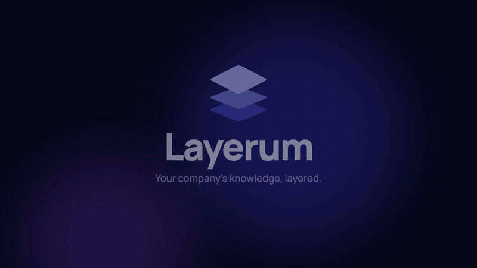
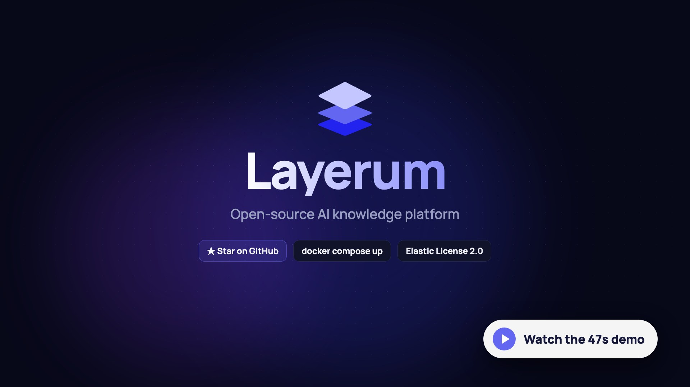
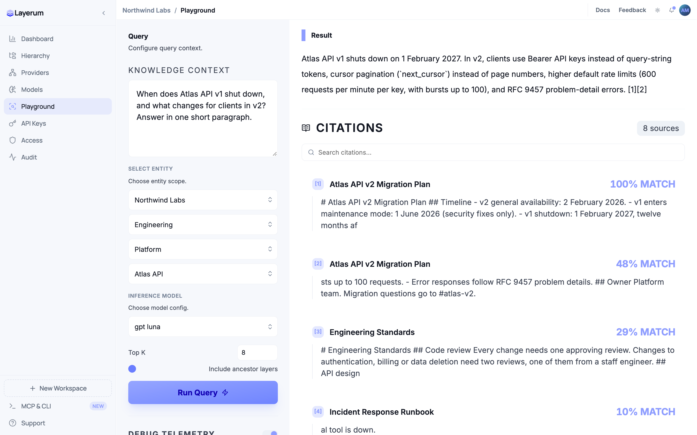
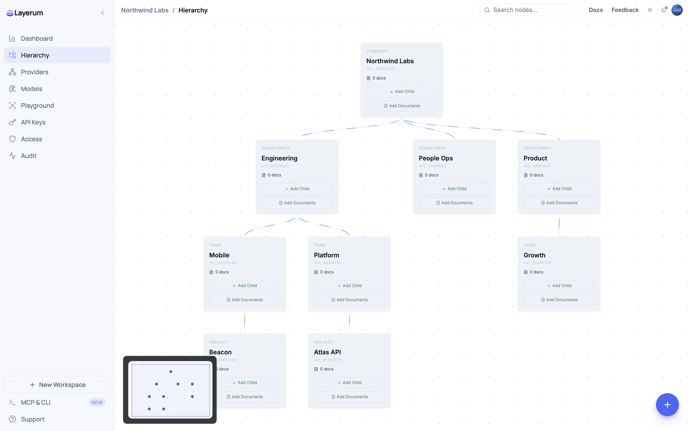
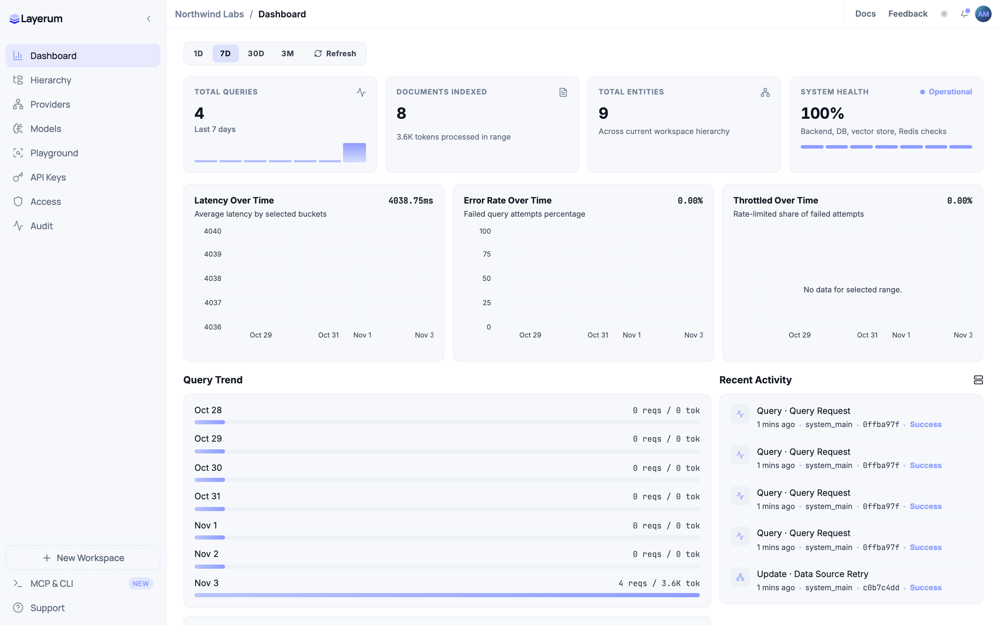
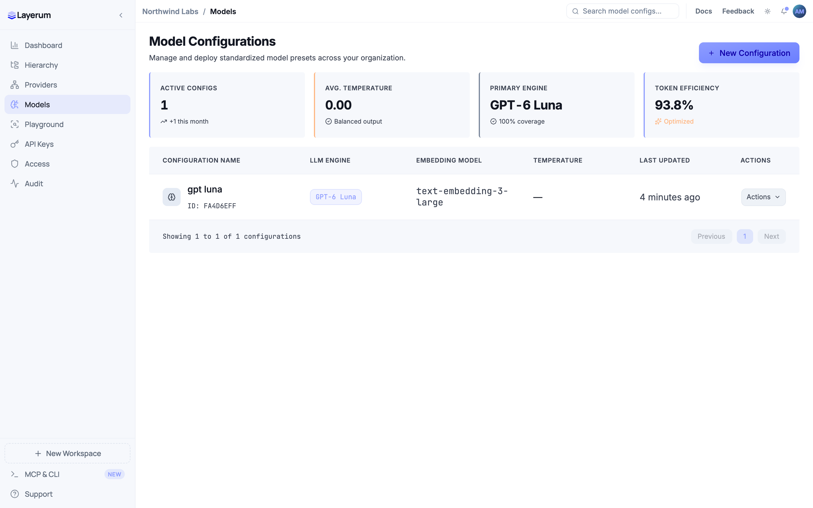

<p align="center">
  
</p>

<h1 align="center">Layerum</h1>

<p align="center">Open-source AI knowledge platform. Your company's knowledge, layered.</p>

<p align="center">
  
</p>

<p align="center">
  <a href="docs/assets/layerum-promo.mp4"></a>
</p>

Layerum is a multi-tenant AI knowledge platform. You organize a workspace as a tree of entities (company → department → team → project), attach documents to any level, and query them with retrieval-augmented generation using your own AI provider keys.

- Hierarchical knowledge with visibility rules per entity
- Files, URLs and text are chunked, embedded and stored in Qdrant, LanceDB or pgvector
- Runs on the bundled database, your own PostgreSQL server or your own Supabase project
- Bring your own model providers and keys, with per-workspace encryption
- Workspace roles, invites, API keys, MFA and audit logs
- REST API, TypeScript SDK, CLI and MCP server for AI assistants

You can run your own Layerum with Docker, or use the hosted version at [layerum.com](https://layerum.com).

## Screenshots

<table>
  <tr>
    <td width="50%">
      <picture>
        <source media="(prefers-color-scheme: dark)" srcset="docs/assets/screenshots/playground-dark.png">
        
      </picture>
      <p align="center"><b>Playground</b></p>
    </td>
    <td width="50%">
      <picture>
        <source media="(prefers-color-scheme: dark)" srcset="docs/assets/screenshots/hierarchy-dark.png">
        
      </picture>
      <p align="center"><b>Hierarchy</b></p>
    </td>
  </tr>
  <tr>
    <td width="50%">
      <picture>
        <source media="(prefers-color-scheme: dark)" srcset="docs/assets/screenshots/dashboard-dark.png">
        
      </picture>
      <p align="center"><b>Dashboard</b></p>
    </td>
    <td width="50%">
      <picture>
        <source media="(prefers-color-scheme: dark)" srcset="docs/assets/screenshots/models-dark.png">
        
      </picture>
      <p align="center"><b>Models</b></p>
    </td>
  </tr>
</table>

## Quick start (Docker)

Requirements: Docker with Compose v2.20 or newer, `openssl`, about 4 GB of RAM.

```sh
git clone <this repository> layerum
cd layerum/docker
./generate-secrets.sh        # creates docker/.env with random secrets
# edit docker/.env: SMTP settings and ADMIN_EMAIL
docker compose up -d --build
```

Open http://localhost:3000 and create an account. The first build takes a few minutes.

Read [docs/self-hosting.md](docs/self-hosting.md) for configuration, running on a domain with TLS, using an external Supabase, Postgres or S3, upgrades and backups. [docs/configuration.md](docs/configuration.md) lists every environment variable.

## Use it from code and AI assistants

CLI ([cli/README.md](cli/README.md)):

```sh
npm i -g @layerum-team/cli
export LAYERUM_APP_URL=http://localhost:3000
export LAYERUM_API_URL=http://localhost:4000
layerum login
layerum query "When does Atlas v1 shut down?" --entity <entity-id>
```

MCP server for Claude Code and other assistants:

```sh
claude mcp add layerum \
  -e LAYERUM_APP_URL=http://localhost:3000 \
  -e LAYERUM_API_URL=http://localhost:4000 \
  -- npx -y @layerum-team/cli mcp
```

TypeScript SDK ([sdk/rag-sdk/README.md](sdk/rag-sdk/README.md)):

```ts
import { LayerumClient } from "@layerum-team/rag-sdk";

const client = new LayerumClient({
  apiKey: process.env.LAYERUM_API_KEY!,
  baseUrl: "http://localhost:4000",
});

const result = await client.query.run({ entityId, modelConfigId, query: "What changed in Atlas v2?" });
console.log(result.answer);
```

## Repository layout

| Path | What it is |
|---|---|
| `backend/` | NestJS API and background worker |
| `frontend/` | Next.js web app |
| `cli/` | `@layerum-team/cli`: command line client and MCP server |
| `sdk/rag-sdk/` | `@layerum-team/rag-sdk`: TypeScript SDK |
| `supabase/migrations/` | Database schema, applied in order |
| `docker/` | Self-hosting stack |

## Development

Run the database, auth, storage, Redis and Qdrant in Docker and the API and web app on your machine. [CONTRIBUTING.md](CONTRIBUTING.md) has the steps.

## License

Layerum is licensed under the [Elastic License 2.0](LICENSE). You may use, modify and self-host it, but you may not provide it to others as a hosted or managed service.

The CLI (`cli/`) and the SDK (`sdk/rag-sdk/`) are licensed under Apache 2.0, so you can use them in any project.

## Security

Please report vulnerabilities privately, as described in [SECURITY.md](SECURITY.md).
